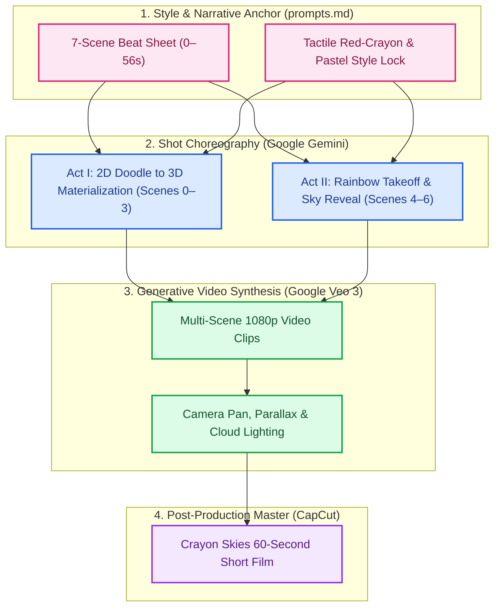

# ✨ Crayon Skies: Multi-Scene AI Video Storytelling with Google Gemini & Veo 3


[](https://github.com/RobinaMirbahar)

> **Author & Architect:** [Robina Mirbahar](https://github.com/RobinaMirbahar) ([Google Developer Expert in Cloud & AI](https://developers.google.com/profile/u/106918534005910641104?utm_campaign=deveco_gdemembers&utm_source=deveco) · Google Cloud Champion Innovator · Co-Author of [*AI Engineering*](https://www.amazon.com/dp/B0GWCZWCF4))  
> **Companion Film & Showcase:** 📺 [Watch *Crayon Skies* on YouTube](https://www.youtube.com/watch?v=qwILtvTzofc) · 🌸 [Companion Repo: *Sofia's Song* (`A-Gemini-Veo-3-Whimsical-Short`)](https://github.com/RobinaMirbahar/A-Gemini-Veo-3-Whimsical-Short)  
> **Core Stack:** [Google Veo 3 on Vertex AI](https://cloud.google.com/vertex-ai/generative-ai/docs/models/veo/3-0-generate-preview?utm_campaign=deveco_gdemembers&utm_source=deveco), [Google Gemini API](https://ai.google.dev/gemini-api/docs?utm_campaign=deveco_gdemembers&utm_source=deveco), [Google AI Studio](https://aistudio.google.com/?utm_campaign=deveco_gdemembers&utm_source=deveco), Tactile Crayon Style Anchors, and CapCut NLE.

---

## 🎬 What is Crayon Skies?

> *“One girl. One crayon. One very curious jet.”*

**Crayon Skies** is a 60-second animated short crafted using **[Google Gemini](https://ai.google.dev/gemini-api/docs?utm_campaign=deveco_gdemembers&utm_source=deveco)** prompt choreography and **[Google Veo 3](https://deepmind.google/models/veo/?utm_campaign=deveco_gdemembers&utm_source=deveco)** video generation. Rather than defaulting to generic glossy CGI, the pipeline locks a **tactile pastel-and-crayon picture-book aesthetic** across seven sequential shots:

* **Preserve Hand-Crafted Crayon Textures:** Maintain consistent wax-crayon strokes, paper grain, and warm bedroom-to-cloud lighting across every scene transition.
* **Lock Whimsical Character & Vehicle Descriptors:** Keep the young creator's yellow hoodie, the **Google Jet** (googly eyes, cookie engines, rainbow vapor trail), the aviator teddy bear (Google *"G"* goggles), and the giraffe co-pilot visually consistent.
* **Choreograph 2D-to-3D Transformation Beats:** Transition seamlessly from flat red-crayon paper scribbles (`Scenes 0–1`) → swirling particle materialization (`Scenes 2–3`) → aerial cloud flight and skywriting finale (`Scenes 4–6`).

---

## 📐 Multi-Scene Storyboard & Synthesis Architecture

> *(🩷 Pink = Style & Character Anchor | 💙 Blue = Gemini Scene Choreography | 💚 Green = Veo 3 1080p Video Synthesis | 💜 Purple = Final Storyboard Cut)*



---

## 🛠️ Core Scene Architecture & Storyboard Matrix

| Scene & Window | Prompt Module | Cinematography, Camera & Veo 3 Mechanics Implemented |
| :--- | :--- | :--- |
| **#0: (Mostly) True Story**<br>`00:00 – 00:08` | [`prompts.md#intro`](prompts.md) | Macro top-down shot of a red wax crayon scribbling the hand-drawn title card across textured sketchbook paper before tilting up to the young creator smiling in her sunlit bedroom. |
| **#1: Doodle Spark**<br>`00:08 – 00:16` | [`prompts.md#scene-1`](prompts.md) | Over-the-shoulder tracking shot as she sketches a whimsical airplane with googly eyes, cookie-shaped turbine engines, and a giraffe pilot wearing Google *"G"* aviator goggles. |
| **#2: Sketch Comes Alive**<br>`00:16 – 00:24` | [`prompts.md#scene-2`](prompts.md) | Magical realism transition: the 2D red-crayon lines begin to glow warm gold, lift off the paper grain, and spin into a vortex of pastel stardust. |
| **#3: Jet Materializes**<br>`00:24 – 00:32` | [`prompts.md#scene-3`](prompts.md) | 2D-to-3D volumetric pop: the full-scale whimsical **Google Jet** materializes right on her bedroom rug, complete with spinning cookie propellers and the aviator teddy bear waving from the cockpit. |
| **#4: Rainbow Takeoff**<br>`00:32 – 00:40` | [`prompts.md#scene-4`](prompts.md) | Dynamic wide tracking shot: she hops aboard, the giraffe co-pilot presses a giant red-crayon launch button, and the jet zooms out into the golden sky leaving a pastel rainbow trail. |
| **#5: Crayon Flight**<br>`00:40 – 00:48` | [`prompts.md#scene-5`](prompts.md) | Aerial chase-cam sweeping through cotton-candy clouds as rainbow vapor trails curl around the wings and the cockpit crew shares joyful laughter. |
| **#6: VEO 3 Sky Reveal**<br>`00:48 – 00:56` | [`prompts.md#scene-6`](prompts.md) | Wide crane pull-back as the jet skywrites **`VEO 3`** across a giant sunlit cloud canvas—closing on the reminder that the boldest ideas often start in red crayon. |

---

## 📦 Reproduction & Production Workflow

1. **Clone the Repository:**
   ```bash
   git clone https://github.com/RobinaMirbahar/crayon-skies-veo3.git
   cd crayon-skies-veo3
   ```
2. **Generate Scene Clips with Gemini + Veo 3:**
   * Open [`prompts.md`](prompts.md) in **[Google AI Studio](https://aistudio.google.com/?utm_campaign=deveco_gdemembers&utm_source=deveco)** / **[Gemini API](https://ai.google.dev/gemini-api/docs?utm_campaign=deveco_gdemembers&utm_source=deveco)** to customize scene prompts.
   * Render each 8-second scene clip in **[Google Cloud Vertex AI (Veo 3)](https://cloud.google.com/vertex-ai/generative-ai/docs/models/veo/3-0-generate-preview?utm_campaign=deveco_gdemembers&utm_source=deveco)** ([DeepMind Veo](https://deepmind.google/models/veo/?utm_campaign=deveco_gdemembers&utm_source=deveco)).
   * Sequence and export the 60-second master cut in **CapCut**.